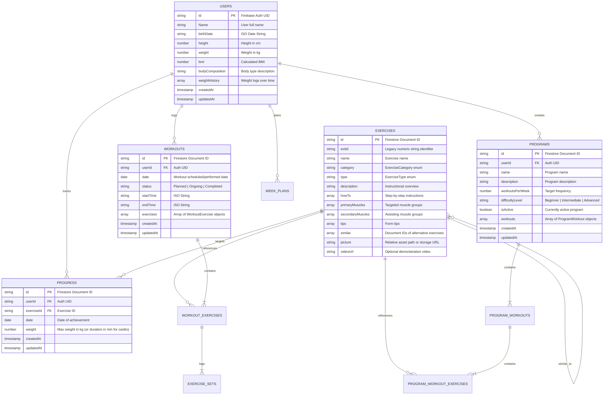

# Gym Assistant — Data Schema Documentation

This document defines the Cloud Firestore data model, collection hierarchies, document schemas, query indexing requirements, and security rules for **Gym Assistant**.

---

## 1. Entity-Relationship Overview



---

## 2. Firestore Collections & Document Schemas

### 2.1 Collection: `users`
*Document ID*: Matches the user's Firebase Auth `UID`.

| Field | Type | Required | Description |
| :--- | :--- | :---: | :--- |
| `id` | `string` | Yes | Firebase Auth UID. |
| `Name` | `string` | Yes | User's display/full name (*Note: see Section 3 for naming issue*). |
| `birthDate` | `string` | Yes | Birth date in `YYYY-MM-DD` format. |
| `height` | `number` | Yes | Height in centimeters (e.g. `180`). |
| `weight` | `number` | Yes | Current body weight in kilograms (e.g. `78.5`). |
| `bmi` | `number` | Yes | Calculated Body Mass Index. |
| `bodyComposition` | `string` | No | Optional physique description (e.g. "Athletic", "Lean"). |
| `weightHistory` | `WeightHistoryEntry[]` | No | Array of `{ date: string, weight: number }` objects. |
| `createdAt` | `Timestamp / Date` | Yes | Document creation timestamp. |
| `updatedAt` | `Timestamp / Date` | Yes | Last update timestamp. |

---

### 2.2 Collection: `exercises`
*Document ID*: Auto-generated Firestore document ID. Global shared catalog.

| Field | Type | Required | Description |
| :--- | :--- | :---: | :--- |
| `id` | `string` | Yes | Document ID. |
| `extId` | `string` | Yes | Stable legacy ID (e.g. `"1"`, `"2"`) used for image asset naming (`/assets/exercises/{extId}.png`). |
| `name` | `string` | Yes | Exercise title (e.g. "Barbell Bench Press"). |
| `category` | `string` | Yes | One of: `"Chest"`, `"Back"`, `"Shoulders"`, `"Biceps"`, `"Triceps"`, `"Legs"`, `"Abs"`, `"Cardio"`. |
| `type` | `string` | Yes | One of: `"Free weights"`, `"Machines"`, `"Cable Machine"`, `"No Equipment"`. |
| `description` | `string` | No | Short overview of the exercise. |
| `howTo` | `string[]` | No | Ordered list of execution steps. |
| `primaryMuscles` | `string[]` | No | Primary muscle groups targeted. |
| `secondaryMuscles` | `string[]` | No | Secondary muscles involved. |
| `tips` | `string[]` | No | Coaching cues and safety advice. |
| `similar` | `string[]` | No | Array of Firestore document IDs of alternative exercises. |
| `picture` | `string` | No | Storage URL or local asset filename. |
| `videoUrl` | `string` | No | Optional video demonstration link. |

---

### 2.3 Collection: `workouts`
*Document ID*: Auto-generated Firestore document ID.

| Field | Type | Required | Description |
| :--- | :--- | :---: | :--- |
| `id` | `string` | Yes | Document ID. |
| `userId` | `string` | Yes | Owner's Firebase Auth UID. |
| `date` | `Date / Timestamp` | Yes | Date the workout is scheduled for or completed on. |
| `status` | `string` | Yes | One of: `"Planned"`, `"Ongoing"`, `"Completed"`. |
| `startTime` | `string` | No | ISO timestamp when workout was started. |
| `endTime` | `string` | No | ISO timestamp when workout was ended. |
| `exercises` | `WorkoutExercise[]` | Yes | Array of embedded exercise objects. |
| `createdAt` | `Date / Timestamp` | Yes | Creation timestamp. |
| `updatedAt` | `Date / Timestamp` | Yes | Last update timestamp. |

#### Embedded Type: `WorkoutExercise`
```typescript
interface WorkoutExercise {
  exerciseId: string;       // References exercises collection doc ID
  exercise?: Exercise;      // Populated on client side for display
  sets: ExerciseSet[];      // Logged sets
  order?: number;           // Display ordering
}
```

#### Embedded Type: `ExerciseSet`
```typescript
interface ExerciseSet {
  weight: number;           // Weight in kg (or duration in min for Cardio)
  reps: number;             // Repetitions performed (0 for Cardio)
  isCompleted: boolean;     // Whether set was completed
}
```

---

### 2.4 Collection: `programs`
*Document ID*: Auto-generated Firestore document ID.

| Field | Type | Required | Description |
| :--- | :--- | :---: | :--- |
| `id` | `string` | Yes | Document ID. |
| `userId` | `string` | Yes | Owner's Firebase Auth UID. |
| `name` | `string` | Yes | Program name (e.g. "Fullbody 3-Day Split"). |
| `description` | `string` | No | Overview of program goals and schedule. |
| `workoutsPerWeek` | `number` | Yes | Planned frequency (e.g. `3`). |
| `difficultyLevel` | `string` | Yes | "Beginner", "Intermediate", or "Advanced". |
| `isActive` | `boolean` | Yes | Whether this is the user's active program. |
| `workouts` | `ProgramWorkout[]` | Yes | Nested workouts belonging to this program. |

#### Embedded Type: `ProgramWorkout`
```typescript
interface ProgramWorkout {
  id: string;               // Unique workout identifier within program
  name: string;             // e.g. "Day A - Push & Quads"
  exercises: ProgramWorkoutExercise[];
}

interface ProgramWorkoutExercise {
  exerciseId: string;       // Exercise document ID
  exercise?: Exercise;      // Hydrated exercise metadata
  sets: number;             // Target sets count
  reps: number;             // Target repetitions count
  order?: number;           // Display index
}
```

---

### 2.5 Collection: `progress`
*Document ID*: Auto-generated Firestore document ID.

| Field | Type | Required | Description |
| :--- | :--- | :---: | :--- |
| `id` | `string` | Yes | Document ID. |
| `userId` | `string` | Yes | Owner's Auth UID. |
| `exerciseId` | `string` | Yes | Target exercise document ID. |
| `date` | `Date / Timestamp` | Yes | Date recorded. |
| `weight` | `number` | Yes | Max weight in kg (or duration in min for cardio). |

---

## 3. Known Data Model Issues to Resolve

1. **Cardio Overload Anti-Pattern**:
   `ExerciseSet.weight` and `Progress.weight` are overloaded to represent time in minutes when `exercise.category === 'Cardio'`. This creates user-facing formatting defects (e.g. `"30 kg Best"` for running).  
   *Target Solution*: Introduce explicit fields or a polymorphic structure (`reps?: number`, `weightKg?: number`, `durationMinutes?: number`).
2. **Casing Discrepancy in `PersonalData`**:
   `PersonalData.Name` is PascalCase, while all other fields across all collections are camelCase (`userId`, `birthDate`, `weightHistory`).
3. **Dead / Unused `UserProfile` Model**:
   `UserProfile` in `src/types/firebase.types.ts` is never used by views; `PersonalData` is used instead. Clean up or consolidate.
4. **Seed Foreign Key Mismatch in `data/seed.ts`**:
   `data/exercises.ts` defines `similar: ["10", "11"]` using `extId` values. When written to Firestore via `addDoc`, new random document IDs are generated, but `similar` is left holding `extId` strings. A two-pass resolution must map `extId` to generated Firestore document IDs.

---

## 4. Required Composite Indexes (`firestore.indexes.json`)

To prevent runtime `FAILED_PRECONDITION` query errors in Firestore, the following indexes are required:

```json
{
  "indexes": [
    {
      "collectionGroup": "workouts",
      "queryScope": "COLLECTION",
      "fields": [
        { "fieldPath": "userId", "order": "ASCENDING" },
        { "fieldPath": "date", "order": "ASCENDING" }
      ]
    },
    {
      "collectionGroup": "programs",
      "queryScope": "COLLECTION",
      "fields": [
        { "fieldPath": "userId", "order": "ASCENDING" },
        { "fieldPath": "createdAt", "order": "DESCENDING" }
      ]
    },
    {
      "collectionGroup": "progress",
      "queryScope": "COLLECTION",
      "fields": [
        { "fieldPath": "userId", "order": "ASCENDING" },
        { "fieldPath": "exerciseId", "order": "ASCENDING" },
        { "fieldPath": "date", "order": "DESCENDING" }
      ]
    }
  ],
  "fieldOverrides": []
}
```

---

## 5. Security Rules Specification (`firestore.rules`)

The security model requires strict user ownership isolation:

```javascript
rules_version = '2';
service cloud.firestore {
  match /databases/{database}/documents {

    function isAuthenticated() {
      return request.auth != null;
    }

    function isOwner(userId) {
      return isAuthenticated() && request.auth.uid == userId;
    }

    // Global exercise catalog: readable by authenticated users; read-only to clients
    match /exercises/{exerciseId} {
      allow read: if isAuthenticated();
      allow write: if false; // Writes restricted to admin / seed CLI
    }

    // User profiles
    match /users/{userId} {
      allow read, write: if isOwner(userId);
    }

    // Workouts
    match /workouts/{workoutId} {
      allow read, write: if isAuthenticated() && (
        resource == null || resource.data.userId == request.auth.uid
      ) && request.resource.data.userId == request.auth.uid;
    }

    // Programs
    match /programs/{programId} {
      allow read, write: if isAuthenticated() && (
        resource == null || resource.data.userId == request.auth.uid
      ) && request.resource.data.userId == request.auth.uid;
    }

    // Progress records
    match /progress/{progressId} {
      allow read, write: if isAuthenticated() && (
        resource == null || resource.data.userId == request.auth.uid
      ) && request.resource.data.userId == request.auth.uid;
    }

    // Weekly plans
    match /week_plans/{planId} {
      allow read, write: if isAuthenticated() && (
        resource == null || resource.data.userId == request.auth.uid
      ) && request.resource.data.userId == request.auth.uid;
    }
  }
}
```
